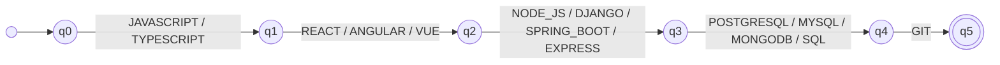
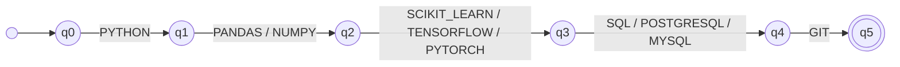
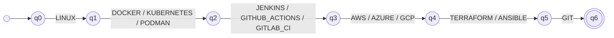
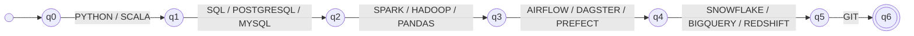

# ResumeLens Formalization: Classification and Candidate Profile DSL

## 1. Qualification Pattern Recognition with Finite Automata

ResumeLens uses deterministic finite automata to determine whether a sequence of normalized qualifications satisfies the qualification pattern defined for a professional profile.

A single general construction is used for every profile. If a profile contains `N` ordered qualification categories, the corresponding automaton contains states `q0, q1, ..., qN`. State `q0` is the initial state and `qN` is the only accepting state.

For each category, every valid qualification produces a transition from the state associated with that category to the next state. Therefore, a candidate is accepted only when the input contains one valid qualification from every required category and follows the canonical category order.

The transition function is deterministic and partial. When no transition exists for a state-symbol pair, the sequence is rejected.

The input of each automaton is the sequence produced by Stage 2: the normalized qualifications, sorted by the categories of the profile, with at most one qualification per category. Each automaton is defined by the 5-tuple **M = (Q, Σ, δ, q0, F)**, where Q is the set of states, Σ the alphabet (the qualifications of the profile), δ the transition function, q0 the initial state and F the set of accepting states.

| Profile | Automaton | Categories | States |
|---|---|---|---|
| Full Stack Developer | M_FS | 5 | 6 |
| Machine Learning Engineer | M_ML | 5 | 6 |
| DevOps Engineer | M_DO | 6 | 7 |
| Data Engineer | M_DE | 6 | 7 |

---

## 1.1 Full Stack Developer

### Pattern represented

The automaton accepts the sequences made of a language (JavaScript or TypeScript), a front-end technology, a back-end technology, a database and Git, in that order. It has 5 categories, therefore 6 states.

### Formal definition

**M_FS = (Q, Σ, δ, q0, F)**

- **Q** = { q0, q1, q2, q3, q4, q5 }
- **Σ** = { ANGULAR, DJANGO, EXPRESS, GIT, JAVASCRIPT, MONGODB, MYSQL, NODE_JS, POSTGRESQL, REACT, SPRING_BOOT, SQL, TYPESCRIPT, VUE }
- **q0** = q0
- **F** = { q5 }
- **δ**: for every category `i` (starting at 0) and every qualification `s` of that category, δ(q_i, s) = q_(i+1). Every other pair (state, symbol) has no transition.

| Category | From | Symbols read | To |
|---|---|---|---|
| `LANGUAGE` | q0 | JAVASCRIPT, TYPESCRIPT | q1 |
| `FRONTEND` | q1 | REACT, ANGULAR, VUE | q2 |
| `BACKEND` | q2 | NODE_JS, DJANGO, SPRING_BOOT, EXPRESS | q3 |
| `DATABASE` | q3 | POSTGRESQL, MYSQL, MONGODB, SQL | q4 |
| `VERSION_CONTROL` | q4 | GIT | q5 |

### Type of automaton

M_FS is a **deterministic finite automaton (DFA)**: it has one initial state, it has no ε-transitions, and for each pair (state, symbol) there is at most one transition, because no qualification belongs to two categories of the same profile. The transition function is partial: a missing transition rejects the sequence, which is equivalent to moving to an implicit dead state.

### Transition diagram



### Examples

| Input sequence | Result | Reason |
|---|---|---|
| JAVASCRIPT, REACT, NODE_JS, POSTGRESQL, GIT | ACCEPTED | one qualification of every category, in order |
| GIT, JAVASCRIPT, REACT, NODE_JS, POSTGRESQL | REJECTED | wrong order: GIT is read in state q0 |
| JAVASCRIPT, REACT, GIT | REJECTED | the BACKEND and DATABASE categories are missing |

---
## 1.2 Machine Learning Engineer

### Pattern represented

The automaton accepts the sequences made of Python, a data-processing library (Pandas or NumPy), a machine-learning framework (Scikit-learn, TensorFlow or PyTorch), a database and Git, in that order. It has 5 categories, therefore 6 states.

### Formal definition

**M_ML = (Q, Σ, δ, q0, F)**

- **Q** = { q0, q1, q2, q3, q4, q5 }
- **Σ** = { GIT, MYSQL, NUMPY, PANDAS, POSTGRESQL, PYTHON, PYTORCH, SCIKIT_LEARN, SQL, TENSORFLOW }
- **q0** = q0
- **F** = { q5 }
- **δ**: for every category `i` (starting at 0) and every qualification `s` of that category, δ(q_i, s) = q_(i+1). Every other pair (state, symbol) has no transition.

| Category | From | Symbols read | To |
|---|---|---|---|
| `LANGUAGE` | q0 | PYTHON | q1 |
| `DATA_PROCESSING` | q1 | PANDAS, NUMPY | q2 |
| `ML_FRAMEWORK` | q2 | SCIKIT_LEARN, TENSORFLOW, PYTORCH | q3 |
| `DATABASE` | q3 | SQL, POSTGRESQL, MYSQL | q4 |
| `VERSION_CONTROL` | q4 | GIT | q5 |

### Type of automaton

M_ML is a **deterministic finite automaton (DFA)**: it has one initial state, it has no ε-transitions, and for each pair (state, symbol) there is at most one transition, because no qualification belongs to two categories of the same profile. The transition function is partial: a missing transition rejects the sequence, which is equivalent to moving to an implicit dead state.

### Transition diagram



### Examples

| Input sequence | Result | Reason |
|---|---|---|
| PYTHON, PANDAS, TENSORFLOW, POSTGRESQL, GIT | ACCEPTED | one qualification of every category, in order |
| PYTHON, PANDAS, GIT | REJECTED | the ML_FRAMEWORK and DATABASE categories are missing |
| PANDAS, PYTHON, TENSORFLOW, SQL, GIT | REJECTED | wrong order: PANDAS is read in state q0 |

---
## 1.3 DevOps Engineer

### Pattern represented

The automaton accepts the sequences made of Linux, a container tool, a CI/CD tool, a cloud provider, an infrastructure-as-code tool and Git, in that order. It has 6 categories, therefore 7 states.

### Formal definition

**M_DO = (Q, Σ, δ, q0, F)**

- **Q** = { q0, q1, q2, q3, q4, q5, q6 }
- **Σ** = { ANSIBLE, AWS, AZURE, DOCKER, GCP, GIT, GITHUB_ACTIONS, GITLAB_CI, JENKINS, KUBERNETES, LINUX, PODMAN, TERRAFORM }
- **q0** = q0
- **F** = { q6 }
- **δ**: for every category `i` (starting at 0) and every qualification `s` of that category, δ(q_i, s) = q_(i+1). Every other pair (state, symbol) has no transition.

| Category | From | Symbols read | To |
|---|---|---|---|
| `OPERATING_SYSTEM` | q0 | LINUX | q1 |
| `CONTAINER` | q1 | DOCKER, KUBERNETES, PODMAN | q2 |
| `CI_CD` | q2 | JENKINS, GITHUB_ACTIONS, GITLAB_CI | q3 |
| `CLOUD` | q3 | AWS, AZURE, GCP | q4 |
| `INFRASTRUCTURE_AS_CODE` | q4 | TERRAFORM, ANSIBLE | q5 |
| `VERSION_CONTROL` | q5 | GIT | q6 |

### Type of automaton

M_DO is a **deterministic finite automaton (DFA)**: it has one initial state, it has no ε-transitions, and for each pair (state, symbol) there is at most one transition, because no qualification belongs to two categories of the same profile. The transition function is partial: a missing transition rejects the sequence, which is equivalent to moving to an implicit dead state.

### Transition diagram



### Examples

| Input sequence | Result | Reason |
|---|---|---|
| LINUX, DOCKER, JENKINS, AWS, TERRAFORM, GIT | ACCEPTED | one qualification of every category, in order |
| LINUX, DOCKER, GIT | REJECTED | the CI_CD, CLOUD and INFRASTRUCTURE_AS_CODE categories are missing |
| DOCKER, LINUX, JENKINS, AWS, TERRAFORM, GIT | REJECTED | wrong order: DOCKER is read in state q0 |

---
## 1.4 Data Engineer

### Pattern represented

The automaton accepts the sequences made of a language (Python or Scala), a database, a data-processing tool, a workflow tool, a data warehouse and Git, in that order. It has 6 categories, therefore 7 states.

### Formal definition

**M_DE = (Q, Σ, δ, q0, F)**

- **Q** = { q0, q1, q2, q3, q4, q5, q6 }
- **Σ** = { AIRFLOW, BIGQUERY, DAGSTER, GIT, HADOOP, MYSQL, PANDAS, POSTGRESQL, PREFECT, PYTHON, REDSHIFT, SCALA, SNOWFLAKE, SPARK, SQL }
- **q0** = q0
- **F** = { q6 }
- **δ**: for every category `i` (starting at 0) and every qualification `s` of that category, δ(q_i, s) = q_(i+1). Every other pair (state, symbol) has no transition.

| Category | From | Symbols read | To |
|---|---|---|---|
| `LANGUAGE` | q0 | PYTHON, SCALA | q1 |
| `DATABASE` | q1 | SQL, POSTGRESQL, MYSQL | q2 |
| `DATA_PROCESSING` | q2 | SPARK, HADOOP, PANDAS | q3 |
| `WORKFLOW` | q3 | AIRFLOW, DAGSTER, PREFECT | q4 |
| `DATA_WAREHOUSE` | q4 | SNOWFLAKE, BIGQUERY, REDSHIFT | q5 |
| `VERSION_CONTROL` | q5 | GIT | q6 |

### Type of automaton

M_DE is a **deterministic finite automaton (DFA)**: it has one initial state, it has no ε-transitions, and for each pair (state, symbol) there is at most one transition, because no qualification belongs to two categories of the same profile. The transition function is partial: a missing transition rejects the sequence, which is equivalent to moving to an implicit dead state.

### Transition diagram



### Examples

| Input sequence | Result | Reason |
|---|---|---|
| PYTHON, SQL, SPARK, AIRFLOW, SNOWFLAKE, GIT | ACCEPTED | one qualification of every category, in order |
| PYTHON, SQL, GIT | REJECTED | the DATA_PROCESSING, WORKFLOW and DATA_WAREHOUSE categories are missing |
| PYTHON, SQL, SPARK, AIRFLOW, SNOWFLAKE | REJECTED | VERSION_CONTROL is missing: the input ends in q5, and only q6 is accepting |

---
## 2. Candidate Profile Domain-Specific Language

After the extraction, normalization, and classification stages, ResumeLens represents the processed candidate information using a domain-specific language.

The language is implemented with textX and describes the structured information of a candidate, including personal information, contact information, education, professional experience, normalized technical skills, and accepted professional profiles.

The DSL is designed to represent the result produced by ResumeLens rather than the original résumé text.

---

## 2.1 EBNF Grammar

The candidate profile language can be represented using the following EBNF notation:

```ebnf
CandidateProfile =
    "candidate", STRING, "{",
        [ Contact ],
        [ Location ],
        [ Role ],
        [ Summary ],
        [ Education ],
        { Experience },
        Skills,
        [ Classification ],
    "}";

Contact =
    "contact", "{",
        [ "email", ":", EMAIL ],
        [ "phone", ":", PHONE ],
        { "link", ":", STRING },
    "}";

Location =
    "location", ":", STRING;

Role =
    "role", ":", STRING;

Summary =
    "summary", ":", STRING;

Education =
    "education", "{",
        { STRING },
    "}";

Experience =
    "experience", "{",
        NON_NEGATIVE_INT, "years",
        STRING,
        [ "role", STRING ],
        [ "organization", STRING ],
        [ Highlights ],
    "}";

Highlights =
    "{",
        { STRING },
    "}";

Skills =
    "skills", "{",
        QUALIFICATION,
        { ",", QUALIFICATION },
    "}";

Classification =
    "classification", "{",
        { ClassificationEntry },
    "}";

ClassificationEntry =
    PROFILE_NAME,
    ":",
    "ACCEPTED",
    "[",
        QUALIFICATION,
        { ",", QUALIFICATION },
    "]";

PROFILE_NAME =
      "FULL_STACK_DEVELOPER"
    | "MACHINE_LEARNING_ENGINEER"
    | "DEVOPS_ENGINEER"
    | "DATA_ENGINEER";

STRING =
    '"', TEXT, '"';

TEXT =
    character sequence excluding double quotes and line breaks;

EMAIL =
    valid local-part,
    "@",
    valid domain,
    ".",
    alphabetic top-level domain;

PHONE =
    [ "+" ],
    digit,
    { digit | space | "(" | ")" | "-" },
    digit;

QUALIFICATION =
    uppercase letter,
    { uppercase letter | digit | "_" };

NON_NEGATIVE_INT =
    "0"
    | non-zero digit, { digit };
```
