# Transducer Catalog (Stage 2)

This annex gives the complete formal definition **M = (Q, Σ, Γ, δ, ω, q0, F)** of each of the 41 finite-state transducers used by ResumeLens, with its transition diagram. The general definition and the construction rule are in [formalization_extraction_normalization.md](formalization_extraction_normalization.md), section 2.

## How to read an entry

- A transducer is built by `build_transducer(canonical, variants)`. It has one independent path for each spelling; the paths share only the initial state `q0`.
- The states of the path of the spelling number `i` (starting at 0) are `v{i}_1, v{i}_2, …`, one state for each character. A transition `v{i}_{j-1} —c→ v{i}_j` reads the character `c`. For `j = 1` the source is `q0`.
- Every transition outputs ε (the empty word) except the last one of each path, which outputs the canonical name. The last state of each path is an accepting state.
- `␣` stands for the space character.
- The entries were generated from the transducers that the program builds, and every spelling was checked to be translated to its canonical name.

## Summary

| # | Canonical name (Γ) | Spellings | Number of states | Number of accepting states |
|---|---|---|---|---|
| 1 | `JAVASCRIPT` | `javascript`, `js`, `java script`, `java-script` | 35 | 4 |
| 2 | `TYPESCRIPT` | `typescript`, `ts`, `type script` | 24 | 3 |
| 3 | `REACT` | `react`, `reactjs`, `react.js`, `react js` | 29 | 4 |
| 4 | `ANGULAR` | `angular`, `angularjs`, `angular.js`, `angular js` | 37 | 4 |
| 5 | `VUE` | `vue`, `vuejs`, `vue.js`, `vue js` | 21 | 4 |
| 6 | `NODE_JS` | `node_js`, `nodejs`, `node.js`, `node js`, `node` | 32 | 5 |
| 7 | `EXPRESS` | `express`, `expressjs`, `express.js` | 27 | 3 |
| 8 | `DJANGO` | `django` | 7 | 1 |
| 9 | `SPRING_BOOT` | `spring_boot`, `springboot`, `spring boot` | 33 | 3 |
| 10 | `POSTGRESQL` | `postgresql`, `postgres`, `postgre sql`, `psql` | 34 | 4 |
| 11 | `MYSQL` | `mysql`, `my sql` | 12 | 2 |
| 12 | `MONGODB` | `mongodb`, `mongo`, `mongo db` | 21 | 3 |
| 13 | `SQL` | `sql` | 4 | 1 |
| 14 | `GIT` | `git` | 4 | 1 |
| 15 | `PYTHON` | `python`, `python3`, `python 3` | 22 | 3 |
| 16 | `PANDAS` | `pandas` | 7 | 1 |
| 17 | `NUMPY` | `numpy`, `num py` | 12 | 2 |
| 18 | `SCIKIT_LEARN` | `scikit_learn`, `scikit-learn`, `scikit learn`, `scikitlearn`, `sklearn` | 55 | 5 |
| 19 | `TENSORFLOW` | `tensorflow`, `tensor flow` | 22 | 2 |
| 20 | `PYTORCH` | `pytorch`, `py torch` | 16 | 2 |
| 21 | `LINUX` | `linux` | 6 | 1 |
| 22 | `DOCKER` | `docker` | 7 | 1 |
| 23 | `KUBERNETES` | `kubernetes`, `k8s` | 14 | 2 |
| 24 | `PODMAN` | `podman` | 7 | 1 |
| 25 | `JENKINS` | `jenkins` | 8 | 1 |
| 26 | `GITHUB_ACTIONS` | `github_actions`, `github actions`, `githubactions` | 42 | 3 |
| 27 | `GITLAB_CI` | `gitlab_ci`, `gitlab ci`, `gitlab-ci`, `gitlab ci/cd`, `gitlabci` | 48 | 5 |
| 28 | `AWS` | `aws`, `amazon web services` | 23 | 2 |
| 29 | `AZURE` | `azure`, `microsoft azure` | 21 | 2 |
| 30 | `GCP` | `gcp`, `google cloud`, `google cloud platform` | 37 | 3 |
| 31 | `TERRAFORM` | `terraform` | 10 | 1 |
| 32 | `ANSIBLE` | `ansible` | 8 | 1 |
| 33 | `SCALA` | `scala` | 6 | 1 |
| 34 | `SPARK` | `spark`, `apache spark`, `pyspark` | 25 | 3 |
| 35 | `HADOOP` | `hadoop`, `apache hadoop` | 20 | 2 |
| 36 | `AIRFLOW` | `airflow`, `apache airflow` | 22 | 2 |
| 37 | `DAGSTER` | `dagster` | 8 | 1 |
| 38 | `PREFECT` | `prefect` | 8 | 1 |
| 39 | `SNOWFLAKE` | `snowflake` | 10 | 1 |
| 40 | `BIGQUERY` | `bigquery`, `big query` | 18 | 2 |
| 41 | `REDSHIFT` | `redshift`, `amazon redshift` | 24 | 2 |

## Definitions

### 1. `JAVASCRIPT`

Spellings: `javascript`, `js`, `java script`, `java-script`

- **Q** = { q0, v0_1 … v0_10, v1_1 … v1_2, v2_1 … v2_11, v3_1 … v3_11 }  (35 states)
- **Σ** = { ␣, -, a, c, i, j, p, r, s, t, v }
- **Γ** = { JAVASCRIPT }
- **q0** = q0
- **F** = { v0_10, v1_2, v2_11, v3_11 }
- **δ** (one path per spelling, each arrow reads one character):

  - `javascript`: q0 —j→ v0_1 —a→ v0_2 —v→ v0_3 —a→ v0_4 —s→ v0_5 —c→ v0_6 —r→ v0_7 —i→ v0_8 —p→ v0_9 —t→ v0_10
  - `js`: q0 —j→ v1_1 —s→ v1_2
  - `java script`: q0 —j→ v2_1 —a→ v2_2 —v→ v2_3 —a→ v2_4 —␣→ v2_5 —s→ v2_6 —c→ v2_7 —r→ v2_8 —i→ v2_9 —p→ v2_10 —t→ v2_11
  - `java-script`: q0 —j→ v3_1 —a→ v3_2 —v→ v3_3 —a→ v3_4 —-→ v3_5 —s→ v3_6 —c→ v3_7 —r→ v3_8 —i→ v3_9 —p→ v3_10 —t→ v3_11

- **ω**: ω(v0_9, t, v0_10) = JAVASCRIPT; ω(v1_1, s, v1_2) = JAVASCRIPT; ω(v2_10, t, v2_11) = JAVASCRIPT; ω(v3_10, t, v3_11) = JAVASCRIPT. Every other transition outputs ε (the empty word).

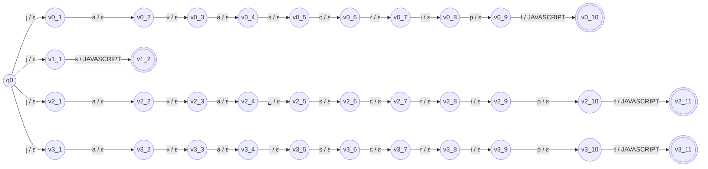

### 2. `TYPESCRIPT`

Spellings: `typescript`, `ts`, `type script`

- **Q** = { q0, v0_1 … v0_10, v1_1 … v1_2, v2_1 … v2_11 }  (24 states)
- **Σ** = { ␣, c, e, i, p, r, s, t, y }
- **Γ** = { TYPESCRIPT }
- **q0** = q0
- **F** = { v0_10, v1_2, v2_11 }
- **δ** (one path per spelling, each arrow reads one character):

  - `typescript`: q0 —t→ v0_1 —y→ v0_2 —p→ v0_3 —e→ v0_4 —s→ v0_5 —c→ v0_6 —r→ v0_7 —i→ v0_8 —p→ v0_9 —t→ v0_10
  - `ts`: q0 —t→ v1_1 —s→ v1_2
  - `type script`: q0 —t→ v2_1 —y→ v2_2 —p→ v2_3 —e→ v2_4 —␣→ v2_5 —s→ v2_6 —c→ v2_7 —r→ v2_8 —i→ v2_9 —p→ v2_10 —t→ v2_11

- **ω**: ω(v0_9, t, v0_10) = TYPESCRIPT; ω(v1_1, s, v1_2) = TYPESCRIPT; ω(v2_10, t, v2_11) = TYPESCRIPT. Every other transition outputs ε (the empty word).

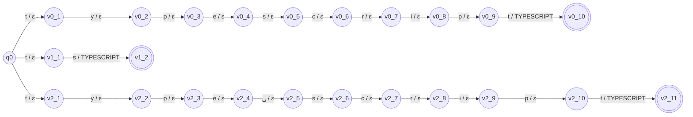

### 3. `REACT`

Spellings: `react`, `reactjs`, `react.js`, `react js`

- **Q** = { q0, v0_1 … v0_5, v1_1 … v1_7, v2_1 … v2_8, v3_1 … v3_8 }  (29 states)
- **Σ** = { ␣, ., a, c, e, j, r, s, t }
- **Γ** = { REACT }
- **q0** = q0
- **F** = { v0_5, v1_7, v2_8, v3_8 }
- **δ** (one path per spelling, each arrow reads one character):

  - `react`: q0 —r→ v0_1 —e→ v0_2 —a→ v0_3 —c→ v0_4 —t→ v0_5
  - `reactjs`: q0 —r→ v1_1 —e→ v1_2 —a→ v1_3 —c→ v1_4 —t→ v1_5 —j→ v1_6 —s→ v1_7
  - `react.js`: q0 —r→ v2_1 —e→ v2_2 —a→ v2_3 —c→ v2_4 —t→ v2_5 —.→ v2_6 —j→ v2_7 —s→ v2_8
  - `react js`: q0 —r→ v3_1 —e→ v3_2 —a→ v3_3 —c→ v3_4 —t→ v3_5 —␣→ v3_6 —j→ v3_7 —s→ v3_8

- **ω**: ω(v0_4, t, v0_5) = REACT; ω(v1_6, s, v1_7) = REACT; ω(v2_7, s, v2_8) = REACT; ω(v3_7, s, v3_8) = REACT. Every other transition outputs ε (the empty word).

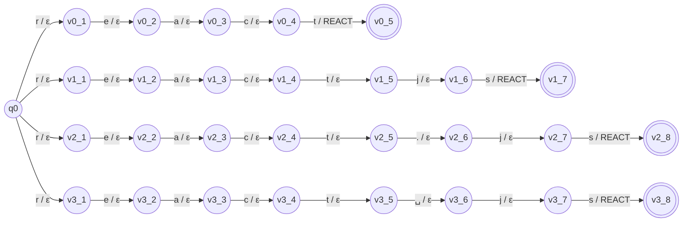

### 4. `ANGULAR`

Spellings: `angular`, `angularjs`, `angular.js`, `angular js`

- **Q** = { q0, v0_1 … v0_7, v1_1 … v1_9, v2_1 … v2_10, v3_1 … v3_10 }  (37 states)
- **Σ** = { ␣, ., a, g, j, l, n, r, s, u }
- **Γ** = { ANGULAR }
- **q0** = q0
- **F** = { v0_7, v1_9, v2_10, v3_10 }
- **δ** (one path per spelling, each arrow reads one character):

  - `angular`: q0 —a→ v0_1 —n→ v0_2 —g→ v0_3 —u→ v0_4 —l→ v0_5 —a→ v0_6 —r→ v0_7
  - `angularjs`: q0 —a→ v1_1 —n→ v1_2 —g→ v1_3 —u→ v1_4 —l→ v1_5 —a→ v1_6 —r→ v1_7 —j→ v1_8 —s→ v1_9
  - `angular.js`: q0 —a→ v2_1 —n→ v2_2 —g→ v2_3 —u→ v2_4 —l→ v2_5 —a→ v2_6 —r→ v2_7 —.→ v2_8 —j→ v2_9 —s→ v2_10
  - `angular js`: q0 —a→ v3_1 —n→ v3_2 —g→ v3_3 —u→ v3_4 —l→ v3_5 —a→ v3_6 —r→ v3_7 —␣→ v3_8 —j→ v3_9 —s→ v3_10

- **ω**: ω(v0_6, r, v0_7) = ANGULAR; ω(v1_8, s, v1_9) = ANGULAR; ω(v2_9, s, v2_10) = ANGULAR; ω(v3_9, s, v3_10) = ANGULAR. Every other transition outputs ε (the empty word).

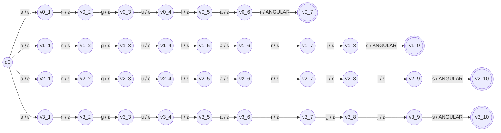

### 5. `VUE`

Spellings: `vue`, `vuejs`, `vue.js`, `vue js`

- **Q** = { q0, v0_1 … v0_3, v1_1 … v1_5, v2_1 … v2_6, v3_1 … v3_6 }  (21 states)
- **Σ** = { ␣, ., e, j, s, u, v }
- **Γ** = { VUE }
- **q0** = q0
- **F** = { v0_3, v1_5, v2_6, v3_6 }
- **δ** (one path per spelling, each arrow reads one character):

  - `vue`: q0 —v→ v0_1 —u→ v0_2 —e→ v0_3
  - `vuejs`: q0 —v→ v1_1 —u→ v1_2 —e→ v1_3 —j→ v1_4 —s→ v1_5
  - `vue.js`: q0 —v→ v2_1 —u→ v2_2 —e→ v2_3 —.→ v2_4 —j→ v2_5 —s→ v2_6
  - `vue js`: q0 —v→ v3_1 —u→ v3_2 —e→ v3_3 —␣→ v3_4 —j→ v3_5 —s→ v3_6

- **ω**: ω(v0_2, e, v0_3) = VUE; ω(v1_4, s, v1_5) = VUE; ω(v2_5, s, v2_6) = VUE; ω(v3_5, s, v3_6) = VUE. Every other transition outputs ε (the empty word).

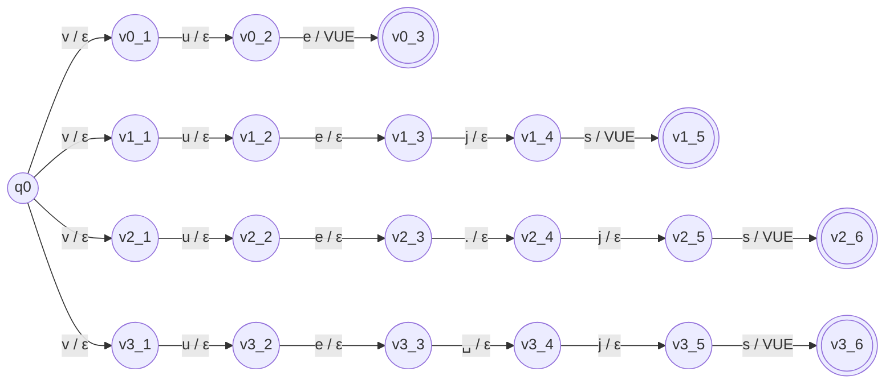

### 6. `NODE_JS`

Spellings: `node_js`, `nodejs`, `node.js`, `node js`, `node`

- **Q** = { q0, v0_1 … v0_7, v1_1 … v1_6, v2_1 … v2_7, v3_1 … v3_7, v4_1 … v4_4 }  (32 states)
- **Σ** = { ␣, ., _, d, e, j, n, o, s }
- **Γ** = { NODE_JS }
- **q0** = q0
- **F** = { v0_7, v1_6, v2_7, v3_7, v4_4 }
- **δ** (one path per spelling, each arrow reads one character):

  - `node_js`: q0 —n→ v0_1 —o→ v0_2 —d→ v0_3 —e→ v0_4 —_→ v0_5 —j→ v0_6 —s→ v0_7
  - `nodejs`: q0 —n→ v1_1 —o→ v1_2 —d→ v1_3 —e→ v1_4 —j→ v1_5 —s→ v1_6
  - `node.js`: q0 —n→ v2_1 —o→ v2_2 —d→ v2_3 —e→ v2_4 —.→ v2_5 —j→ v2_6 —s→ v2_7
  - `node js`: q0 —n→ v3_1 —o→ v3_2 —d→ v3_3 —e→ v3_4 —␣→ v3_5 —j→ v3_6 —s→ v3_7
  - `node`: q0 —n→ v4_1 —o→ v4_2 —d→ v4_3 —e→ v4_4

- **ω**: ω(v0_6, s, v0_7) = NODE_JS; ω(v1_5, s, v1_6) = NODE_JS; ω(v2_6, s, v2_7) = NODE_JS; ω(v3_6, s, v3_7) = NODE_JS; ω(v4_3, e, v4_4) = NODE_JS. Every other transition outputs ε (the empty word).

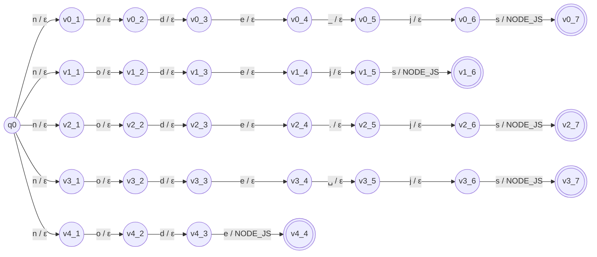

### 7. `EXPRESS`

Spellings: `express`, `expressjs`, `express.js`

- **Q** = { q0, v0_1 … v0_7, v1_1 … v1_9, v2_1 … v2_10 }  (27 states)
- **Σ** = { ., e, j, p, r, s, x }
- **Γ** = { EXPRESS }
- **q0** = q0
- **F** = { v0_7, v1_9, v2_10 }
- **δ** (one path per spelling, each arrow reads one character):

  - `express`: q0 —e→ v0_1 —x→ v0_2 —p→ v0_3 —r→ v0_4 —e→ v0_5 —s→ v0_6 —s→ v0_7
  - `expressjs`: q0 —e→ v1_1 —x→ v1_2 —p→ v1_3 —r→ v1_4 —e→ v1_5 —s→ v1_6 —s→ v1_7 —j→ v1_8 —s→ v1_9
  - `express.js`: q0 —e→ v2_1 —x→ v2_2 —p→ v2_3 —r→ v2_4 —e→ v2_5 —s→ v2_6 —s→ v2_7 —.→ v2_8 —j→ v2_9 —s→ v2_10

- **ω**: ω(v0_6, s, v0_7) = EXPRESS; ω(v1_8, s, v1_9) = EXPRESS; ω(v2_9, s, v2_10) = EXPRESS. Every other transition outputs ε (the empty word).

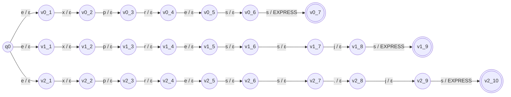

### 8. `DJANGO`

Spellings: `django`

- **Q** = { q0, v0_1 … v0_6 }  (7 states)
- **Σ** = { a, d, g, j, n, o }
- **Γ** = { DJANGO }
- **q0** = q0
- **F** = { v0_6 }
- **δ** (one path per spelling, each arrow reads one character):

  - `django`: q0 —d→ v0_1 —j→ v0_2 —a→ v0_3 —n→ v0_4 —g→ v0_5 —o→ v0_6

- **ω**: ω(v0_5, o, v0_6) = DJANGO. Every other transition outputs ε (the empty word).

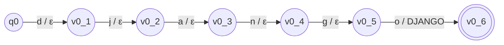

### 9. `SPRING_BOOT`

Spellings: `spring_boot`, `springboot`, `spring boot`

- **Q** = { q0, v0_1 … v0_11, v1_1 … v1_10, v2_1 … v2_11 }  (33 states)
- **Σ** = { ␣, _, b, g, i, n, o, p, r, s, t }
- **Γ** = { SPRING_BOOT }
- **q0** = q0
- **F** = { v0_11, v1_10, v2_11 }
- **δ** (one path per spelling, each arrow reads one character):

  - `spring_boot`: q0 —s→ v0_1 —p→ v0_2 —r→ v0_3 —i→ v0_4 —n→ v0_5 —g→ v0_6 —_→ v0_7 —b→ v0_8 —o→ v0_9 —o→ v0_10 —t→ v0_11
  - `springboot`: q0 —s→ v1_1 —p→ v1_2 —r→ v1_3 —i→ v1_4 —n→ v1_5 —g→ v1_6 —b→ v1_7 —o→ v1_8 —o→ v1_9 —t→ v1_10
  - `spring boot`: q0 —s→ v2_1 —p→ v2_2 —r→ v2_3 —i→ v2_4 —n→ v2_5 —g→ v2_6 —␣→ v2_7 —b→ v2_8 —o→ v2_9 —o→ v2_10 —t→ v2_11

- **ω**: ω(v0_10, t, v0_11) = SPRING_BOOT; ω(v1_9, t, v1_10) = SPRING_BOOT; ω(v2_10, t, v2_11) = SPRING_BOOT. Every other transition outputs ε (the empty word).

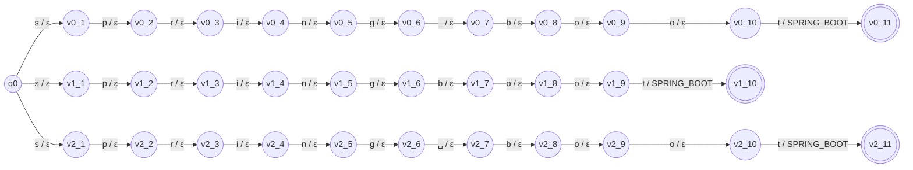

### 10. `POSTGRESQL`

Spellings: `postgresql`, `postgres`, `postgre sql`, `psql`

- **Q** = { q0, v0_1 … v0_10, v1_1 … v1_8, v2_1 … v2_11, v3_1 … v3_4 }  (34 states)
- **Σ** = { ␣, e, g, l, o, p, q, r, s, t }
- **Γ** = { POSTGRESQL }
- **q0** = q0
- **F** = { v0_10, v1_8, v2_11, v3_4 }
- **δ** (one path per spelling, each arrow reads one character):

  - `postgresql`: q0 —p→ v0_1 —o→ v0_2 —s→ v0_3 —t→ v0_4 —g→ v0_5 —r→ v0_6 —e→ v0_7 —s→ v0_8 —q→ v0_9 —l→ v0_10
  - `postgres`: q0 —p→ v1_1 —o→ v1_2 —s→ v1_3 —t→ v1_4 —g→ v1_5 —r→ v1_6 —e→ v1_7 —s→ v1_8
  - `postgre sql`: q0 —p→ v2_1 —o→ v2_2 —s→ v2_3 —t→ v2_4 —g→ v2_5 —r→ v2_6 —e→ v2_7 —␣→ v2_8 —s→ v2_9 —q→ v2_10 —l→ v2_11
  - `psql`: q0 —p→ v3_1 —s→ v3_2 —q→ v3_3 —l→ v3_4

- **ω**: ω(v0_9, l, v0_10) = POSTGRESQL; ω(v1_7, s, v1_8) = POSTGRESQL; ω(v2_10, l, v2_11) = POSTGRESQL; ω(v3_3, l, v3_4) = POSTGRESQL. Every other transition outputs ε (the empty word).

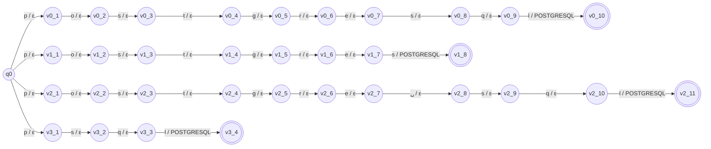

### 11. `MYSQL`

Spellings: `mysql`, `my sql`

- **Q** = { q0, v0_1 … v0_5, v1_1 … v1_6 }  (12 states)
- **Σ** = { ␣, l, m, q, s, y }
- **Γ** = { MYSQL }
- **q0** = q0
- **F** = { v0_5, v1_6 }
- **δ** (one path per spelling, each arrow reads one character):

  - `mysql`: q0 —m→ v0_1 —y→ v0_2 —s→ v0_3 —q→ v0_4 —l→ v0_5
  - `my sql`: q0 —m→ v1_1 —y→ v1_2 —␣→ v1_3 —s→ v1_4 —q→ v1_5 —l→ v1_6

- **ω**: ω(v0_4, l, v0_5) = MYSQL; ω(v1_5, l, v1_6) = MYSQL. Every other transition outputs ε (the empty word).


### 12. `MONGODB`

Spellings: `mongodb`, `mongo`, `mongo db`

- **Q** = { q0, v0_1 … v0_7, v1_1 … v1_5, v2_1 … v2_8 }  (21 states)
- **Σ** = { ␣, b, d, g, m, n, o }
- **Γ** = { MONGODB }
- **q0** = q0
- **F** = { v0_7, v1_5, v2_8 }
- **δ** (one path per spelling, each arrow reads one character):

  - `mongodb`: q0 —m→ v0_1 —o→ v0_2 —n→ v0_3 —g→ v0_4 —o→ v0_5 —d→ v0_6 —b→ v0_7
  - `mongo`: q0 —m→ v1_1 —o→ v1_2 —n→ v1_3 —g→ v1_4 —o→ v1_5
  - `mongo db`: q0 —m→ v2_1 —o→ v2_2 —n→ v2_3 —g→ v2_4 —o→ v2_5 —␣→ v2_6 —d→ v2_7 —b→ v2_8

- **ω**: ω(v0_6, b, v0_7) = MONGODB; ω(v1_4, o, v1_5) = MONGODB; ω(v2_7, b, v2_8) = MONGODB. Every other transition outputs ε (the empty word).

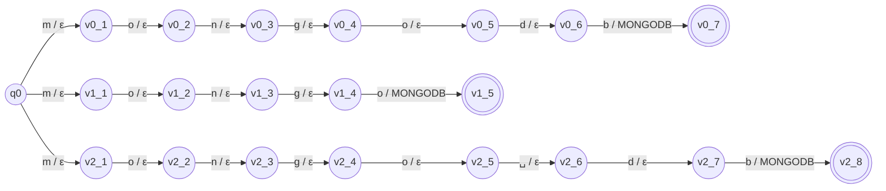

### 13. `SQL`

Spellings: `sql`

- **Q** = { q0, v0_1 … v0_3 }  (4 states)
- **Σ** = { l, q, s }
- **Γ** = { SQL }
- **q0** = q0
- **F** = { v0_3 }
- **δ** (one path per spelling, each arrow reads one character):

  - `sql`: q0 —s→ v0_1 —q→ v0_2 —l→ v0_3

- **ω**: ω(v0_2, l, v0_3) = SQL. Every other transition outputs ε (the empty word).

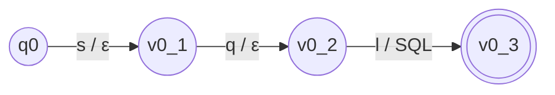

### 14. `GIT`

Spellings: `git`

- **Q** = { q0, v0_1 … v0_3 }  (4 states)
- **Σ** = { g, i, t }
- **Γ** = { GIT }
- **q0** = q0
- **F** = { v0_3 }
- **δ** (one path per spelling, each arrow reads one character):

  - `git`: q0 —g→ v0_1 —i→ v0_2 —t→ v0_3

- **ω**: ω(v0_2, t, v0_3) = GIT. Every other transition outputs ε (the empty word).

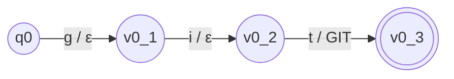

### 15. `PYTHON`

Spellings: `python`, `python3`, `python 3`

- **Q** = { q0, v0_1 … v0_6, v1_1 … v1_7, v2_1 … v2_8 }  (22 states)
- **Σ** = { ␣, 3, h, n, o, p, t, y }
- **Γ** = { PYTHON }
- **q0** = q0
- **F** = { v0_6, v1_7, v2_8 }
- **δ** (one path per spelling, each arrow reads one character):

  - `python`: q0 —p→ v0_1 —y→ v0_2 —t→ v0_3 —h→ v0_4 —o→ v0_5 —n→ v0_6
  - `python3`: q0 —p→ v1_1 —y→ v1_2 —t→ v1_3 —h→ v1_4 —o→ v1_5 —n→ v1_6 —3→ v1_7
  - `python 3`: q0 —p→ v2_1 —y→ v2_2 —t→ v2_3 —h→ v2_4 —o→ v2_5 —n→ v2_6 —␣→ v2_7 —3→ v2_8

- **ω**: ω(v0_5, n, v0_6) = PYTHON; ω(v1_6, 3, v1_7) = PYTHON; ω(v2_7, 3, v2_8) = PYTHON. Every other transition outputs ε (the empty word).

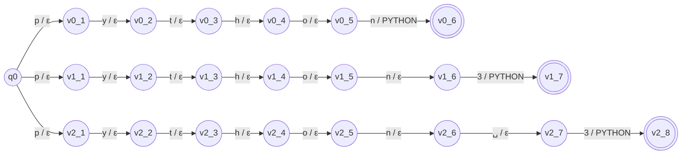

### 16. `PANDAS`

Spellings: `pandas`

- **Q** = { q0, v0_1 … v0_6 }  (7 states)
- **Σ** = { a, d, n, p, s }
- **Γ** = { PANDAS }
- **q0** = q0
- **F** = { v0_6 }
- **δ** (one path per spelling, each arrow reads one character):

  - `pandas`: q0 —p→ v0_1 —a→ v0_2 —n→ v0_3 —d→ v0_4 —a→ v0_5 —s→ v0_6

- **ω**: ω(v0_5, s, v0_6) = PANDAS. Every other transition outputs ε (the empty word).

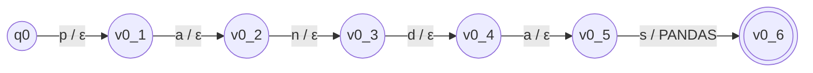

### 17. `NUMPY`

Spellings: `numpy`, `num py`

- **Q** = { q0, v0_1 … v0_5, v1_1 … v1_6 }  (12 states)
- **Σ** = { ␣, m, n, p, u, y }
- **Γ** = { NUMPY }
- **q0** = q0
- **F** = { v0_5, v1_6 }
- **δ** (one path per spelling, each arrow reads one character):

  - `numpy`: q0 —n→ v0_1 —u→ v0_2 —m→ v0_3 —p→ v0_4 —y→ v0_5
  - `num py`: q0 —n→ v1_1 —u→ v1_2 —m→ v1_3 —␣→ v1_4 —p→ v1_5 —y→ v1_6

- **ω**: ω(v0_4, y, v0_5) = NUMPY; ω(v1_5, y, v1_6) = NUMPY. Every other transition outputs ε (the empty word).

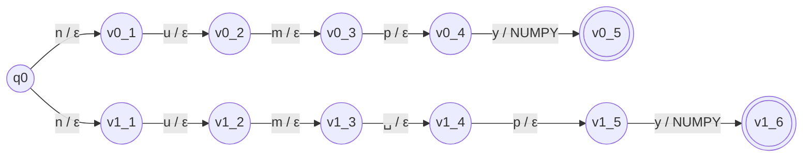

### 18. `SCIKIT_LEARN`

Spellings: `scikit_learn`, `scikit-learn`, `scikit learn`, `scikitlearn`, `sklearn`

- **Q** = { q0, v0_1 … v0_12, v1_1 … v1_12, v2_1 … v2_12, v3_1 … v3_11, v4_1 … v4_7 }  (55 states)
- **Σ** = { ␣, -, _, a, c, e, i, k, l, n, r, s, t }
- **Γ** = { SCIKIT_LEARN }
- **q0** = q0
- **F** = { v0_12, v1_12, v2_12, v3_11, v4_7 }
- **δ** (one path per spelling, each arrow reads one character):

  - `scikit_learn`: q0 —s→ v0_1 —c→ v0_2 —i→ v0_3 —k→ v0_4 —i→ v0_5 —t→ v0_6 —_→ v0_7 —l→ v0_8 —e→ v0_9 —a→ v0_10 —r→ v0_11 —n→ v0_12
  - `scikit-learn`: q0 —s→ v1_1 —c→ v1_2 —i→ v1_3 —k→ v1_4 —i→ v1_5 —t→ v1_6 —-→ v1_7 —l→ v1_8 —e→ v1_9 —a→ v1_10 —r→ v1_11 —n→ v1_12
  - `scikit learn`: q0 —s→ v2_1 —c→ v2_2 —i→ v2_3 —k→ v2_4 —i→ v2_5 —t→ v2_6 —␣→ v2_7 —l→ v2_8 —e→ v2_9 —a→ v2_10 —r→ v2_11 —n→ v2_12
  - `scikitlearn`: q0 —s→ v3_1 —c→ v3_2 —i→ v3_3 —k→ v3_4 —i→ v3_5 —t→ v3_6 —l→ v3_7 —e→ v3_8 —a→ v3_9 —r→ v3_10 —n→ v3_11
  - `sklearn`: q0 —s→ v4_1 —k→ v4_2 —l→ v4_3 —e→ v4_4 —a→ v4_5 —r→ v4_6 —n→ v4_7

- **ω**: ω(v0_11, n, v0_12) = SCIKIT_LEARN; ω(v1_11, n, v1_12) = SCIKIT_LEARN; ω(v2_11, n, v2_12) = SCIKIT_LEARN; ω(v3_10, n, v3_11) = SCIKIT_LEARN; ω(v4_6, n, v4_7) = SCIKIT_LEARN. Every other transition outputs ε (the empty word).

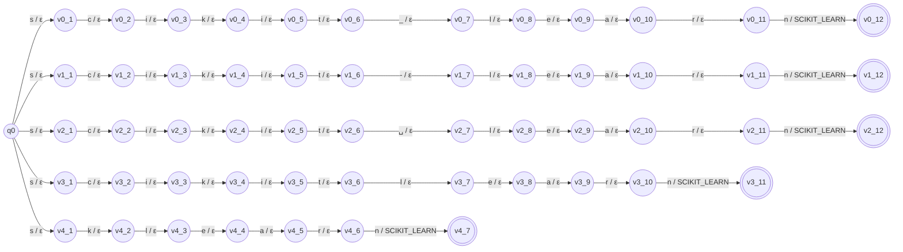

### 19. `TENSORFLOW`

Spellings: `tensorflow`, `tensor flow`

- **Q** = { q0, v0_1 … v0_10, v1_1 … v1_11 }  (22 states)
- **Σ** = { ␣, e, f, l, n, o, r, s, t, w }
- **Γ** = { TENSORFLOW }
- **q0** = q0
- **F** = { v0_10, v1_11 }
- **δ** (one path per spelling, each arrow reads one character):

  - `tensorflow`: q0 —t→ v0_1 —e→ v0_2 —n→ v0_3 —s→ v0_4 —o→ v0_5 —r→ v0_6 —f→ v0_7 —l→ v0_8 —o→ v0_9 —w→ v0_10
  - `tensor flow`: q0 —t→ v1_1 —e→ v1_2 —n→ v1_3 —s→ v1_4 —o→ v1_5 —r→ v1_6 —␣→ v1_7 —f→ v1_8 —l→ v1_9 —o→ v1_10 —w→ v1_11

- **ω**: ω(v0_9, w, v0_10) = TENSORFLOW; ω(v1_10, w, v1_11) = TENSORFLOW. Every other transition outputs ε (the empty word).

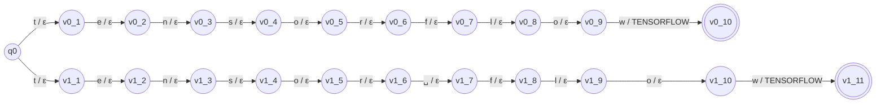

### 20. `PYTORCH`

Spellings: `pytorch`, `py torch`

- **Q** = { q0, v0_1 … v0_7, v1_1 … v1_8 }  (16 states)
- **Σ** = { ␣, c, h, o, p, r, t, y }
- **Γ** = { PYTORCH }
- **q0** = q0
- **F** = { v0_7, v1_8 }
- **δ** (one path per spelling, each arrow reads one character):

  - `pytorch`: q0 —p→ v0_1 —y→ v0_2 —t→ v0_3 —o→ v0_4 —r→ v0_5 —c→ v0_6 —h→ v0_7
  - `py torch`: q0 —p→ v1_1 —y→ v1_2 —␣→ v1_3 —t→ v1_4 —o→ v1_5 —r→ v1_6 —c→ v1_7 —h→ v1_8

- **ω**: ω(v0_6, h, v0_7) = PYTORCH; ω(v1_7, h, v1_8) = PYTORCH. Every other transition outputs ε (the empty word).

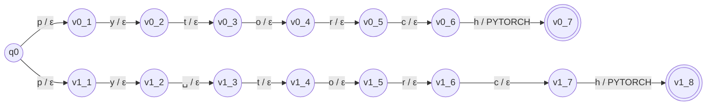

### 21. `LINUX`

Spellings: `linux`

- **Q** = { q0, v0_1 … v0_5 }  (6 states)
- **Σ** = { i, l, n, u, x }
- **Γ** = { LINUX }
- **q0** = q0
- **F** = { v0_5 }
- **δ** (one path per spelling, each arrow reads one character):

  - `linux`: q0 —l→ v0_1 —i→ v0_2 —n→ v0_3 —u→ v0_4 —x→ v0_5

- **ω**: ω(v0_4, x, v0_5) = LINUX. Every other transition outputs ε (the empty word).

```mermaid
graph LR
    q0((q0))
    v0_1((v0_1))
    v0_2((v0_2))
    v0_3((v0_3))
    v0_4((v0_4))
    v0_5(((v0_5)))
    q0 -- "l / ε" --> v0_1
    v0_1 -- "i / ε" --> v0_2
    v0_2 -- "n / ε" --> v0_3
    v0_3 -- "u / ε" --> v0_4
    v0_4 -- "x / LINUX" --> v0_5
```

### 22. `DOCKER`

Spellings: `docker`

- **Q** = { q0, v0_1 … v0_6 }  (7 states)
- **Σ** = { c, d, e, k, o, r }
- **Γ** = { DOCKER }
- **q0** = q0
- **F** = { v0_6 }
- **δ** (one path per spelling, each arrow reads one character):

  - `docker`: q0 —d→ v0_1 —o→ v0_2 —c→ v0_3 —k→ v0_4 —e→ v0_5 —r→ v0_6

- **ω**: ω(v0_5, r, v0_6) = DOCKER. Every other transition outputs ε (the empty word).

```mermaid
graph LR
    q0((q0))
    v0_1((v0_1))
    v0_2((v0_2))
    v0_3((v0_3))
    v0_4((v0_4))
    v0_5((v0_5))
    v0_6(((v0_6)))
    q0 -- "d / ε" --> v0_1
    v0_1 -- "o / ε" --> v0_2
    v0_2 -- "c / ε" --> v0_3
    v0_3 -- "k / ε" --> v0_4
    v0_4 -- "e / ε" --> v0_5
    v0_5 -- "r / DOCKER" --> v0_6
```

### 23. `KUBERNETES`

Spellings: `kubernetes`, `k8s`

- **Q** = { q0, v0_1 … v0_10, v1_1 … v1_3 }  (14 states)
- **Σ** = { 8, b, e, k, n, r, s, t, u }
- **Γ** = { KUBERNETES }
- **q0** = q0
- **F** = { v0_10, v1_3 }
- **δ** (one path per spelling, each arrow reads one character):

  - `kubernetes`: q0 —k→ v0_1 —u→ v0_2 —b→ v0_3 —e→ v0_4 —r→ v0_5 —n→ v0_6 —e→ v0_7 —t→ v0_8 —e→ v0_9 —s→ v0_10
  - `k8s`: q0 —k→ v1_1 —8→ v1_2 —s→ v1_3

- **ω**: ω(v0_9, s, v0_10) = KUBERNETES; ω(v1_2, s, v1_3) = KUBERNETES. Every other transition outputs ε (the empty word).

```mermaid
graph LR
    q0((q0))
    v0_1((v0_1))
    v0_2((v0_2))
    v0_3((v0_3))
    v0_4((v0_4))
    v0_5((v0_5))
    v0_6((v0_6))
    v0_7((v0_7))
    v0_8((v0_8))
    v0_9((v0_9))
    v0_10(((v0_10)))
    v1_1((v1_1))
    v1_2((v1_2))
    v1_3(((v1_3)))
    q0 -- "k / ε" --> v0_1
    v0_1 -- "u / ε" --> v0_2
    v0_2 -- "b / ε" --> v0_3
    v0_3 -- "e / ε" --> v0_4
    v0_4 -- "r / ε" --> v0_5
    v0_5 -- "n / ε" --> v0_6
    v0_6 -- "e / ε" --> v0_7
    v0_7 -- "t / ε" --> v0_8
    v0_8 -- "e / ε" --> v0_9
    v0_9 -- "s / KUBERNETES" --> v0_10
    q0 -- "k / ε" --> v1_1
    v1_1 -- "8 / ε" --> v1_2
    v1_2 -- "s / KUBERNETES" --> v1_3
```

### 24. `PODMAN`

Spellings: `podman`

- **Q** = { q0, v0_1 … v0_6 }  (7 states)
- **Σ** = { a, d, m, n, o, p }
- **Γ** = { PODMAN }
- **q0** = q0
- **F** = { v0_6 }
- **δ** (one path per spelling, each arrow reads one character):

  - `podman`: q0 —p→ v0_1 —o→ v0_2 —d→ v0_3 —m→ v0_4 —a→ v0_5 —n→ v0_6

- **ω**: ω(v0_5, n, v0_6) = PODMAN. Every other transition outputs ε (the empty word).

```mermaid
graph LR
    q0((q0))
    v0_1((v0_1))
    v0_2((v0_2))
    v0_3((v0_3))
    v0_4((v0_4))
    v0_5((v0_5))
    v0_6(((v0_6)))
    q0 -- "p / ε" --> v0_1
    v0_1 -- "o / ε" --> v0_2
    v0_2 -- "d / ε" --> v0_3
    v0_3 -- "m / ε" --> v0_4
    v0_4 -- "a / ε" --> v0_5
    v0_5 -- "n / PODMAN" --> v0_6
```

### 25. `JENKINS`

Spellings: `jenkins`

- **Q** = { q0, v0_1 … v0_7 }  (8 states)
- **Σ** = { e, i, j, k, n, s }
- **Γ** = { JENKINS }
- **q0** = q0
- **F** = { v0_7 }
- **δ** (one path per spelling, each arrow reads one character):

  - `jenkins`: q0 —j→ v0_1 —e→ v0_2 —n→ v0_3 —k→ v0_4 —i→ v0_5 —n→ v0_6 —s→ v0_7

- **ω**: ω(v0_6, s, v0_7) = JENKINS. Every other transition outputs ε (the empty word).

```mermaid
graph LR
    q0((q0))
    v0_1((v0_1))
    v0_2((v0_2))
    v0_3((v0_3))
    v0_4((v0_4))
    v0_5((v0_5))
    v0_6((v0_6))
    v0_7(((v0_7)))
    q0 -- "j / ε" --> v0_1
    v0_1 -- "e / ε" --> v0_2
    v0_2 -- "n / ε" --> v0_3
    v0_3 -- "k / ε" --> v0_4
    v0_4 -- "i / ε" --> v0_5
    v0_5 -- "n / ε" --> v0_6
    v0_6 -- "s / JENKINS" --> v0_7
```

### 26. `GITHUB_ACTIONS`

Spellings: `github_actions`, `github actions`, `githubactions`

- **Q** = { q0, v0_1 … v0_14, v1_1 … v1_14, v2_1 … v2_13 }  (42 states)
- **Σ** = { ␣, _, a, b, c, g, h, i, n, o, s, t, u }
- **Γ** = { GITHUB_ACTIONS }
- **q0** = q0
- **F** = { v0_14, v1_14, v2_13 }
- **δ** (one path per spelling, each arrow reads one character):

  - `github_actions`: q0 —g→ v0_1 —i→ v0_2 —t→ v0_3 —h→ v0_4 —u→ v0_5 —b→ v0_6 —_→ v0_7 —a→ v0_8 —c→ v0_9 —t→ v0_10 —i→ v0_11 —o→ v0_12 —n→ v0_13 —s→ v0_14
  - `github actions`: q0 —g→ v1_1 —i→ v1_2 —t→ v1_3 —h→ v1_4 —u→ v1_5 —b→ v1_6 —␣→ v1_7 —a→ v1_8 —c→ v1_9 —t→ v1_10 —i→ v1_11 —o→ v1_12 —n→ v1_13 —s→ v1_14
  - `githubactions`: q0 —g→ v2_1 —i→ v2_2 —t→ v2_3 —h→ v2_4 —u→ v2_5 —b→ v2_6 —a→ v2_7 —c→ v2_8 —t→ v2_9 —i→ v2_10 —o→ v2_11 —n→ v2_12 —s→ v2_13

- **ω**: ω(v0_13, s, v0_14) = GITHUB_ACTIONS; ω(v1_13, s, v1_14) = GITHUB_ACTIONS; ω(v2_12, s, v2_13) = GITHUB_ACTIONS. Every other transition outputs ε (the empty word).

```mermaid
graph LR
    q0((q0))
    v0_1((v0_1))
    v0_2((v0_2))
    v0_3((v0_3))
    v0_4((v0_4))
    v0_5((v0_5))
    v0_6((v0_6))
    v0_7((v0_7))
    v0_8((v0_8))
    v0_9((v0_9))
    v0_10((v0_10))
    v0_11((v0_11))
    v0_12((v0_12))
    v0_13((v0_13))
    v0_14(((v0_14)))
    v1_1((v1_1))
    v1_2((v1_2))
    v1_3((v1_3))
    v1_4((v1_4))
    v1_5((v1_5))
    v1_6((v1_6))
    v1_7((v1_7))
    v1_8((v1_8))
    v1_9((v1_9))
    v1_10((v1_10))
    v1_11((v1_11))
    v1_12((v1_12))
    v1_13((v1_13))
    v1_14(((v1_14)))
    v2_1((v2_1))
    v2_2((v2_2))
    v2_3((v2_3))
    v2_4((v2_4))
    v2_5((v2_5))
    v2_6((v2_6))
    v2_7((v2_7))
    v2_8((v2_8))
    v2_9((v2_9))
    v2_10((v2_10))
    v2_11((v2_11))
    v2_12((v2_12))
    v2_13(((v2_13)))
    q0 -- "g / ε" --> v0_1
    v0_1 -- "i / ε" --> v0_2
    v0_2 -- "t / ε" --> v0_3
    v0_3 -- "h / ε" --> v0_4
    v0_4 -- "u / ε" --> v0_5
    v0_5 -- "b / ε" --> v0_6
    v0_6 -- "_ / ε" --> v0_7
    v0_7 -- "a / ε" --> v0_8
    v0_8 -- "c / ε" --> v0_9
    v0_9 -- "t / ε" --> v0_10
    v0_10 -- "i / ε" --> v0_11
    v0_11 -- "o / ε" --> v0_12
    v0_12 -- "n / ε" --> v0_13
    v0_13 -- "s / GITHUB_ACTIONS" --> v0_14
    q0 -- "g / ε" --> v1_1
    v1_1 -- "i / ε" --> v1_2
    v1_2 -- "t / ε" --> v1_3
    v1_3 -- "h / ε" --> v1_4
    v1_4 -- "u / ε" --> v1_5
    v1_5 -- "b / ε" --> v1_6
    v1_6 -- "␣ / ε" --> v1_7
    v1_7 -- "a / ε" --> v1_8
    v1_8 -- "c / ε" --> v1_9
    v1_9 -- "t / ε" --> v1_10
    v1_10 -- "i / ε" --> v1_11
    v1_11 -- "o / ε" --> v1_12
    v1_12 -- "n / ε" --> v1_13
    v1_13 -- "s / GITHUB_ACTIONS" --> v1_14
    q0 -- "g / ε" --> v2_1
    v2_1 -- "i / ε" --> v2_2
    v2_2 -- "t / ε" --> v2_3
    v2_3 -- "h / ε" --> v2_4
    v2_4 -- "u / ε" --> v2_5
    v2_5 -- "b / ε" --> v2_6
    v2_6 -- "a / ε" --> v2_7
    v2_7 -- "c / ε" --> v2_8
    v2_8 -- "t / ε" --> v2_9
    v2_9 -- "i / ε" --> v2_10
    v2_10 -- "o / ε" --> v2_11
    v2_11 -- "n / ε" --> v2_12
    v2_12 -- "s / GITHUB_ACTIONS" --> v2_13
```

### 27. `GITLAB_CI`

Spellings: `gitlab_ci`, `gitlab ci`, `gitlab-ci`, `gitlab ci/cd`, `gitlabci`

- **Q** = { q0, v0_1 … v0_9, v1_1 … v1_9, v2_1 … v2_9, v3_1 … v3_12, v4_1 … v4_8 }  (48 states)
- **Σ** = { ␣, -, /, _, a, b, c, d, g, i, l, t }
- **Γ** = { GITLAB_CI }
- **q0** = q0
- **F** = { v0_9, v1_9, v2_9, v3_12, v4_8 }
- **δ** (one path per spelling, each arrow reads one character):

  - `gitlab_ci`: q0 —g→ v0_1 —i→ v0_2 —t→ v0_3 —l→ v0_4 —a→ v0_5 —b→ v0_6 —_→ v0_7 —c→ v0_8 —i→ v0_9
  - `gitlab ci`: q0 —g→ v1_1 —i→ v1_2 —t→ v1_3 —l→ v1_4 —a→ v1_5 —b→ v1_6 —␣→ v1_7 —c→ v1_8 —i→ v1_9
  - `gitlab-ci`: q0 —g→ v2_1 —i→ v2_2 —t→ v2_3 —l→ v2_4 —a→ v2_5 —b→ v2_6 —-→ v2_7 —c→ v2_8 —i→ v2_9
  - `gitlab ci/cd`: q0 —g→ v3_1 —i→ v3_2 —t→ v3_3 —l→ v3_4 —a→ v3_5 —b→ v3_6 —␣→ v3_7 —c→ v3_8 —i→ v3_9 —/→ v3_10 —c→ v3_11 —d→ v3_12
  - `gitlabci`: q0 —g→ v4_1 —i→ v4_2 —t→ v4_3 —l→ v4_4 —a→ v4_5 —b→ v4_6 —c→ v4_7 —i→ v4_8

- **ω**: ω(v0_8, i, v0_9) = GITLAB_CI; ω(v1_8, i, v1_9) = GITLAB_CI; ω(v2_8, i, v2_9) = GITLAB_CI; ω(v3_11, d, v3_12) = GITLAB_CI; ω(v4_7, i, v4_8) = GITLAB_CI. Every other transition outputs ε (the empty word).

```mermaid
graph LR
    q0((q0))
    v0_1((v0_1))
    v0_2((v0_2))
    v0_3((v0_3))
    v0_4((v0_4))
    v0_5((v0_5))
    v0_6((v0_6))
    v0_7((v0_7))
    v0_8((v0_8))
    v0_9(((v0_9)))
    v1_1((v1_1))
    v1_2((v1_2))
    v1_3((v1_3))
    v1_4((v1_4))
    v1_5((v1_5))
    v1_6((v1_6))
    v1_7((v1_7))
    v1_8((v1_8))
    v1_9(((v1_9)))
    v2_1((v2_1))
    v2_2((v2_2))
    v2_3((v2_3))
    v2_4((v2_4))
    v2_5((v2_5))
    v2_6((v2_6))
    v2_7((v2_7))
    v2_8((v2_8))
    v2_9(((v2_9)))
    v3_1((v3_1))
    v3_2((v3_2))
    v3_3((v3_3))
    v3_4((v3_4))
    v3_5((v3_5))
    v3_6((v3_6))
    v3_7((v3_7))
    v3_8((v3_8))
    v3_9((v3_9))
    v3_10((v3_10))
    v3_11((v3_11))
    v3_12(((v3_12)))
    v4_1((v4_1))
    v4_2((v4_2))
    v4_3((v4_3))
    v4_4((v4_4))
    v4_5((v4_5))
    v4_6((v4_6))
    v4_7((v4_7))
    v4_8(((v4_8)))
    q0 -- "g / ε" --> v0_1
    v0_1 -- "i / ε" --> v0_2
    v0_2 -- "t / ε" --> v0_3
    v0_3 -- "l / ε" --> v0_4
    v0_4 -- "a / ε" --> v0_5
    v0_5 -- "b / ε" --> v0_6
    v0_6 -- "_ / ε" --> v0_7
    v0_7 -- "c / ε" --> v0_8
    v0_8 -- "i / GITLAB_CI" --> v0_9
    q0 -- "g / ε" --> v1_1
    v1_1 -- "i / ε" --> v1_2
    v1_2 -- "t / ε" --> v1_3
    v1_3 -- "l / ε" --> v1_4
    v1_4 -- "a / ε" --> v1_5
    v1_5 -- "b / ε" --> v1_6
    v1_6 -- "␣ / ε" --> v1_7
    v1_7 -- "c / ε" --> v1_8
    v1_8 -- "i / GITLAB_CI" --> v1_9
    q0 -- "g / ε" --> v2_1
    v2_1 -- "i / ε" --> v2_2
    v2_2 -- "t / ε" --> v2_3
    v2_3 -- "l / ε" --> v2_4
    v2_4 -- "a / ε" --> v2_5
    v2_5 -- "b / ε" --> v2_6
    v2_6 -- "- / ε" --> v2_7
    v2_7 -- "c / ε" --> v2_8
    v2_8 -- "i / GITLAB_CI" --> v2_9
    q0 -- "g / ε" --> v3_1
    v3_1 -- "i / ε" --> v3_2
    v3_2 -- "t / ε" --> v3_3
    v3_3 -- "l / ε" --> v3_4
    v3_4 -- "a / ε" --> v3_5
    v3_5 -- "b / ε" --> v3_6
    v3_6 -- "␣ / ε" --> v3_7
    v3_7 -- "c / ε" --> v3_8
    v3_8 -- "i / ε" --> v3_9
    v3_9 -- "/ / ε" --> v3_10
    v3_10 -- "c / ε" --> v3_11
    v3_11 -- "d / GITLAB_CI" --> v3_12
    q0 -- "g / ε" --> v4_1
    v4_1 -- "i / ε" --> v4_2
    v4_2 -- "t / ε" --> v4_3
    v4_3 -- "l / ε" --> v4_4
    v4_4 -- "a / ε" --> v4_5
    v4_5 -- "b / ε" --> v4_6
    v4_6 -- "c / ε" --> v4_7
    v4_7 -- "i / GITLAB_CI" --> v4_8
```

### 28. `AWS`

Spellings: `aws`, `amazon web services`

- **Q** = { q0, v0_1 … v0_3, v1_1 … v1_19 }  (23 states)
- **Σ** = { ␣, a, b, c, e, i, m, n, o, r, s, v, w, z }
- **Γ** = { AWS }
- **q0** = q0
- **F** = { v0_3, v1_19 }
- **δ** (one path per spelling, each arrow reads one character):

  - `aws`: q0 —a→ v0_1 —w→ v0_2 —s→ v0_3
  - `amazon web services`: q0 —a→ v1_1 —m→ v1_2 —a→ v1_3 —z→ v1_4 —o→ v1_5 —n→ v1_6 —␣→ v1_7 —w→ v1_8 —e→ v1_9 —b→ v1_10 —␣→ v1_11 —s→ v1_12 —e→ v1_13 —r→ v1_14 —v→ v1_15 —i→ v1_16 —c→ v1_17 —e→ v1_18 —s→ v1_19

- **ω**: ω(v0_2, s, v0_3) = AWS; ω(v1_18, s, v1_19) = AWS. Every other transition outputs ε (the empty word).

```mermaid
graph LR
    q0((q0))
    v0_1((v0_1))
    v0_2((v0_2))
    v0_3(((v0_3)))
    v1_1((v1_1))
    v1_2((v1_2))
    v1_3((v1_3))
    v1_4((v1_4))
    v1_5((v1_5))
    v1_6((v1_6))
    v1_7((v1_7))
    v1_8((v1_8))
    v1_9((v1_9))
    v1_10((v1_10))
    v1_11((v1_11))
    v1_12((v1_12))
    v1_13((v1_13))
    v1_14((v1_14))
    v1_15((v1_15))
    v1_16((v1_16))
    v1_17((v1_17))
    v1_18((v1_18))
    v1_19(((v1_19)))
    q0 -- "a / ε" --> v0_1
    v0_1 -- "w / ε" --> v0_2
    v0_2 -- "s / AWS" --> v0_3
    q0 -- "a / ε" --> v1_1
    v1_1 -- "m / ε" --> v1_2
    v1_2 -- "a / ε" --> v1_3
    v1_3 -- "z / ε" --> v1_4
    v1_4 -- "o / ε" --> v1_5
    v1_5 -- "n / ε" --> v1_6
    v1_6 -- "␣ / ε" --> v1_7
    v1_7 -- "w / ε" --> v1_8
    v1_8 -- "e / ε" --> v1_9
    v1_9 -- "b / ε" --> v1_10
    v1_10 -- "␣ / ε" --> v1_11
    v1_11 -- "s / ε" --> v1_12
    v1_12 -- "e / ε" --> v1_13
    v1_13 -- "r / ε" --> v1_14
    v1_14 -- "v / ε" --> v1_15
    v1_15 -- "i / ε" --> v1_16
    v1_16 -- "c / ε" --> v1_17
    v1_17 -- "e / ε" --> v1_18
    v1_18 -- "s / AWS" --> v1_19
```

### 29. `AZURE`

Spellings: `azure`, `microsoft azure`

- **Q** = { q0, v0_1 … v0_5, v1_1 … v1_15 }  (21 states)
- **Σ** = { ␣, a, c, e, f, i, m, o, r, s, t, u, z }
- **Γ** = { AZURE }
- **q0** = q0
- **F** = { v0_5, v1_15 }
- **δ** (one path per spelling, each arrow reads one character):

  - `azure`: q0 —a→ v0_1 —z→ v0_2 —u→ v0_3 —r→ v0_4 —e→ v0_5
  - `microsoft azure`: q0 —m→ v1_1 —i→ v1_2 —c→ v1_3 —r→ v1_4 —o→ v1_5 —s→ v1_6 —o→ v1_7 —f→ v1_8 —t→ v1_9 —␣→ v1_10 —a→ v1_11 —z→ v1_12 —u→ v1_13 —r→ v1_14 —e→ v1_15

- **ω**: ω(v0_4, e, v0_5) = AZURE; ω(v1_14, e, v1_15) = AZURE. Every other transition outputs ε (the empty word).

```mermaid
graph LR
    q0((q0))
    v0_1((v0_1))
    v0_2((v0_2))
    v0_3((v0_3))
    v0_4((v0_4))
    v0_5(((v0_5)))
    v1_1((v1_1))
    v1_2((v1_2))
    v1_3((v1_3))
    v1_4((v1_4))
    v1_5((v1_5))
    v1_6((v1_6))
    v1_7((v1_7))
    v1_8((v1_8))
    v1_9((v1_9))
    v1_10((v1_10))
    v1_11((v1_11))
    v1_12((v1_12))
    v1_13((v1_13))
    v1_14((v1_14))
    v1_15(((v1_15)))
    q0 -- "a / ε" --> v0_1
    v0_1 -- "z / ε" --> v0_2
    v0_2 -- "u / ε" --> v0_3
    v0_3 -- "r / ε" --> v0_4
    v0_4 -- "e / AZURE" --> v0_5
    q0 -- "m / ε" --> v1_1
    v1_1 -- "i / ε" --> v1_2
    v1_2 -- "c / ε" --> v1_3
    v1_3 -- "r / ε" --> v1_4
    v1_4 -- "o / ε" --> v1_5
    v1_5 -- "s / ε" --> v1_6
    v1_6 -- "o / ε" --> v1_7
    v1_7 -- "f / ε" --> v1_8
    v1_8 -- "t / ε" --> v1_9
    v1_9 -- "␣ / ε" --> v1_10
    v1_10 -- "a / ε" --> v1_11
    v1_11 -- "z / ε" --> v1_12
    v1_12 -- "u / ε" --> v1_13
    v1_13 -- "r / ε" --> v1_14
    v1_14 -- "e / AZURE" --> v1_15
```

### 30. `GCP`

Spellings: `gcp`, `google cloud`, `google cloud platform`

- **Q** = { q0, v0_1 … v0_3, v1_1 … v1_12, v2_1 … v2_21 }  (37 states)
- **Σ** = { ␣, a, c, d, e, f, g, l, m, o, p, r, t, u }
- **Γ** = { GCP }
- **q0** = q0
- **F** = { v0_3, v1_12, v2_21 }
- **δ** (one path per spelling, each arrow reads one character):

  - `gcp`: q0 —g→ v0_1 —c→ v0_2 —p→ v0_3
  - `google cloud`: q0 —g→ v1_1 —o→ v1_2 —o→ v1_3 —g→ v1_4 —l→ v1_5 —e→ v1_6 —␣→ v1_7 —c→ v1_8 —l→ v1_9 —o→ v1_10 —u→ v1_11 —d→ v1_12
  - `google cloud platform`: q0 —g→ v2_1 —o→ v2_2 —o→ v2_3 —g→ v2_4 —l→ v2_5 —e→ v2_6 —␣→ v2_7 —c→ v2_8 —l→ v2_9 —o→ v2_10 —u→ v2_11 —d→ v2_12 —␣→ v2_13 —p→ v2_14 —l→ v2_15 —a→ v2_16 —t→ v2_17 —f→ v2_18 —o→ v2_19 —r→ v2_20 —m→ v2_21

- **ω**: ω(v0_2, p, v0_3) = GCP; ω(v1_11, d, v1_12) = GCP; ω(v2_20, m, v2_21) = GCP. Every other transition outputs ε (the empty word).

```mermaid
graph LR
    q0((q0))
    v0_1((v0_1))
    v0_2((v0_2))
    v0_3(((v0_3)))
    v1_1((v1_1))
    v1_2((v1_2))
    v1_3((v1_3))
    v1_4((v1_4))
    v1_5((v1_5))
    v1_6((v1_6))
    v1_7((v1_7))
    v1_8((v1_8))
    v1_9((v1_9))
    v1_10((v1_10))
    v1_11((v1_11))
    v1_12(((v1_12)))
    v2_1((v2_1))
    v2_2((v2_2))
    v2_3((v2_3))
    v2_4((v2_4))
    v2_5((v2_5))
    v2_6((v2_6))
    v2_7((v2_7))
    v2_8((v2_8))
    v2_9((v2_9))
    v2_10((v2_10))
    v2_11((v2_11))
    v2_12((v2_12))
    v2_13((v2_13))
    v2_14((v2_14))
    v2_15((v2_15))
    v2_16((v2_16))
    v2_17((v2_17))
    v2_18((v2_18))
    v2_19((v2_19))
    v2_20((v2_20))
    v2_21(((v2_21)))
    q0 -- "g / ε" --> v0_1
    v0_1 -- "c / ε" --> v0_2
    v0_2 -- "p / GCP" --> v0_3
    q0 -- "g / ε" --> v1_1
    v1_1 -- "o / ε" --> v1_2
    v1_2 -- "o / ε" --> v1_3
    v1_3 -- "g / ε" --> v1_4
    v1_4 -- "l / ε" --> v1_5
    v1_5 -- "e / ε" --> v1_6
    v1_6 -- "␣ / ε" --> v1_7
    v1_7 -- "c / ε" --> v1_8
    v1_8 -- "l / ε" --> v1_9
    v1_9 -- "o / ε" --> v1_10
    v1_10 -- "u / ε" --> v1_11
    v1_11 -- "d / GCP" --> v1_12
    q0 -- "g / ε" --> v2_1
    v2_1 -- "o / ε" --> v2_2
    v2_2 -- "o / ε" --> v2_3
    v2_3 -- "g / ε" --> v2_4
    v2_4 -- "l / ε" --> v2_5
    v2_5 -- "e / ε" --> v2_6
    v2_6 -- "␣ / ε" --> v2_7
    v2_7 -- "c / ε" --> v2_8
    v2_8 -- "l / ε" --> v2_9
    v2_9 -- "o / ε" --> v2_10
    v2_10 -- "u / ε" --> v2_11
    v2_11 -- "d / ε" --> v2_12
    v2_12 -- "␣ / ε" --> v2_13
    v2_13 -- "p / ε" --> v2_14
    v2_14 -- "l / ε" --> v2_15
    v2_15 -- "a / ε" --> v2_16
    v2_16 -- "t / ε" --> v2_17
    v2_17 -- "f / ε" --> v2_18
    v2_18 -- "o / ε" --> v2_19
    v2_19 -- "r / ε" --> v2_20
    v2_20 -- "m / GCP" --> v2_21
```

### 31. `TERRAFORM`

Spellings: `terraform`

- **Q** = { q0, v0_1 … v0_9 }  (10 states)
- **Σ** = { a, e, f, m, o, r, t }
- **Γ** = { TERRAFORM }
- **q0** = q0
- **F** = { v0_9 }
- **δ** (one path per spelling, each arrow reads one character):

  - `terraform`: q0 —t→ v0_1 —e→ v0_2 —r→ v0_3 —r→ v0_4 —a→ v0_5 —f→ v0_6 —o→ v0_7 —r→ v0_8 —m→ v0_9

- **ω**: ω(v0_8, m, v0_9) = TERRAFORM. Every other transition outputs ε (the empty word).

```mermaid
graph LR
    q0((q0))
    v0_1((v0_1))
    v0_2((v0_2))
    v0_3((v0_3))
    v0_4((v0_4))
    v0_5((v0_5))
    v0_6((v0_6))
    v0_7((v0_7))
    v0_8((v0_8))
    v0_9(((v0_9)))
    q0 -- "t / ε" --> v0_1
    v0_1 -- "e / ε" --> v0_2
    v0_2 -- "r / ε" --> v0_3
    v0_3 -- "r / ε" --> v0_4
    v0_4 -- "a / ε" --> v0_5
    v0_5 -- "f / ε" --> v0_6
    v0_6 -- "o / ε" --> v0_7
    v0_7 -- "r / ε" --> v0_8
    v0_8 -- "m / TERRAFORM" --> v0_9
```

### 32. `ANSIBLE`

Spellings: `ansible`

- **Q** = { q0, v0_1 … v0_7 }  (8 states)
- **Σ** = { a, b, e, i, l, n, s }
- **Γ** = { ANSIBLE }
- **q0** = q0
- **F** = { v0_7 }
- **δ** (one path per spelling, each arrow reads one character):

  - `ansible`: q0 —a→ v0_1 —n→ v0_2 —s→ v0_3 —i→ v0_4 —b→ v0_5 —l→ v0_6 —e→ v0_7

- **ω**: ω(v0_6, e, v0_7) = ANSIBLE. Every other transition outputs ε (the empty word).

```mermaid
graph LR
    q0((q0))
    v0_1((v0_1))
    v0_2((v0_2))
    v0_3((v0_3))
    v0_4((v0_4))
    v0_5((v0_5))
    v0_6((v0_6))
    v0_7(((v0_7)))
    q0 -- "a / ε" --> v0_1
    v0_1 -- "n / ε" --> v0_2
    v0_2 -- "s / ε" --> v0_3
    v0_3 -- "i / ε" --> v0_4
    v0_4 -- "b / ε" --> v0_5
    v0_5 -- "l / ε" --> v0_6
    v0_6 -- "e / ANSIBLE" --> v0_7
```

### 33. `SCALA`

Spellings: `scala`

- **Q** = { q0, v0_1 … v0_5 }  (6 states)
- **Σ** = { a, c, l, s }
- **Γ** = { SCALA }
- **q0** = q0
- **F** = { v0_5 }
- **δ** (one path per spelling, each arrow reads one character):

  - `scala`: q0 —s→ v0_1 —c→ v0_2 —a→ v0_3 —l→ v0_4 —a→ v0_5

- **ω**: ω(v0_4, a, v0_5) = SCALA. Every other transition outputs ε (the empty word).

```mermaid
graph LR
    q0((q0))
    v0_1((v0_1))
    v0_2((v0_2))
    v0_3((v0_3))
    v0_4((v0_4))
    v0_5(((v0_5)))
    q0 -- "s / ε" --> v0_1
    v0_1 -- "c / ε" --> v0_2
    v0_2 -- "a / ε" --> v0_3
    v0_3 -- "l / ε" --> v0_4
    v0_4 -- "a / SCALA" --> v0_5
```

### 34. `SPARK`

Spellings: `spark`, `apache spark`, `pyspark`

- **Q** = { q0, v0_1 … v0_5, v1_1 … v1_12, v2_1 … v2_7 }  (25 states)
- **Σ** = { ␣, a, c, e, h, k, p, r, s, y }
- **Γ** = { SPARK }
- **q0** = q0
- **F** = { v0_5, v1_12, v2_7 }
- **δ** (one path per spelling, each arrow reads one character):

  - `spark`: q0 —s→ v0_1 —p→ v0_2 —a→ v0_3 —r→ v0_4 —k→ v0_5
  - `apache spark`: q0 —a→ v1_1 —p→ v1_2 —a→ v1_3 —c→ v1_4 —h→ v1_5 —e→ v1_6 —␣→ v1_7 —s→ v1_8 —p→ v1_9 —a→ v1_10 —r→ v1_11 —k→ v1_12
  - `pyspark`: q0 —p→ v2_1 —y→ v2_2 —s→ v2_3 —p→ v2_4 —a→ v2_5 —r→ v2_6 —k→ v2_7

- **ω**: ω(v0_4, k, v0_5) = SPARK; ω(v1_11, k, v1_12) = SPARK; ω(v2_6, k, v2_7) = SPARK. Every other transition outputs ε (the empty word).

```mermaid
graph LR
    q0((q0))
    v0_1((v0_1))
    v0_2((v0_2))
    v0_3((v0_3))
    v0_4((v0_4))
    v0_5(((v0_5)))
    v1_1((v1_1))
    v1_2((v1_2))
    v1_3((v1_3))
    v1_4((v1_4))
    v1_5((v1_5))
    v1_6((v1_6))
    v1_7((v1_7))
    v1_8((v1_8))
    v1_9((v1_9))
    v1_10((v1_10))
    v1_11((v1_11))
    v1_12(((v1_12)))
    v2_1((v2_1))
    v2_2((v2_2))
    v2_3((v2_3))
    v2_4((v2_4))
    v2_5((v2_5))
    v2_6((v2_6))
    v2_7(((v2_7)))
    q0 -- "s / ε" --> v0_1
    v0_1 -- "p / ε" --> v0_2
    v0_2 -- "a / ε" --> v0_3
    v0_3 -- "r / ε" --> v0_4
    v0_4 -- "k / SPARK" --> v0_5
    q0 -- "a / ε" --> v1_1
    v1_1 -- "p / ε" --> v1_2
    v1_2 -- "a / ε" --> v1_3
    v1_3 -- "c / ε" --> v1_4
    v1_4 -- "h / ε" --> v1_5
    v1_5 -- "e / ε" --> v1_6
    v1_6 -- "␣ / ε" --> v1_7
    v1_7 -- "s / ε" --> v1_8
    v1_8 -- "p / ε" --> v1_9
    v1_9 -- "a / ε" --> v1_10
    v1_10 -- "r / ε" --> v1_11
    v1_11 -- "k / SPARK" --> v1_12
    q0 -- "p / ε" --> v2_1
    v2_1 -- "y / ε" --> v2_2
    v2_2 -- "s / ε" --> v2_3
    v2_3 -- "p / ε" --> v2_4
    v2_4 -- "a / ε" --> v2_5
    v2_5 -- "r / ε" --> v2_6
    v2_6 -- "k / SPARK" --> v2_7
```

### 35. `HADOOP`

Spellings: `hadoop`, `apache hadoop`

- **Q** = { q0, v0_1 … v0_6, v1_1 … v1_13 }  (20 states)
- **Σ** = { ␣, a, c, d, e, h, o, p }
- **Γ** = { HADOOP }
- **q0** = q0
- **F** = { v0_6, v1_13 }
- **δ** (one path per spelling, each arrow reads one character):

  - `hadoop`: q0 —h→ v0_1 —a→ v0_2 —d→ v0_3 —o→ v0_4 —o→ v0_5 —p→ v0_6
  - `apache hadoop`: q0 —a→ v1_1 —p→ v1_2 —a→ v1_3 —c→ v1_4 —h→ v1_5 —e→ v1_6 —␣→ v1_7 —h→ v1_8 —a→ v1_9 —d→ v1_10 —o→ v1_11 —o→ v1_12 —p→ v1_13

- **ω**: ω(v0_5, p, v0_6) = HADOOP; ω(v1_12, p, v1_13) = HADOOP. Every other transition outputs ε (the empty word).

```mermaid
graph LR
    q0((q0))
    v0_1((v0_1))
    v0_2((v0_2))
    v0_3((v0_3))
    v0_4((v0_4))
    v0_5((v0_5))
    v0_6(((v0_6)))
    v1_1((v1_1))
    v1_2((v1_2))
    v1_3((v1_3))
    v1_4((v1_4))
    v1_5((v1_5))
    v1_6((v1_6))
    v1_7((v1_7))
    v1_8((v1_8))
    v1_9((v1_9))
    v1_10((v1_10))
    v1_11((v1_11))
    v1_12((v1_12))
    v1_13(((v1_13)))
    q0 -- "h / ε" --> v0_1
    v0_1 -- "a / ε" --> v0_2
    v0_2 -- "d / ε" --> v0_3
    v0_3 -- "o / ε" --> v0_4
    v0_4 -- "o / ε" --> v0_5
    v0_5 -- "p / HADOOP" --> v0_6
    q0 -- "a / ε" --> v1_1
    v1_1 -- "p / ε" --> v1_2
    v1_2 -- "a / ε" --> v1_3
    v1_3 -- "c / ε" --> v1_4
    v1_4 -- "h / ε" --> v1_5
    v1_5 -- "e / ε" --> v1_6
    v1_6 -- "␣ / ε" --> v1_7
    v1_7 -- "h / ε" --> v1_8
    v1_8 -- "a / ε" --> v1_9
    v1_9 -- "d / ε" --> v1_10
    v1_10 -- "o / ε" --> v1_11
    v1_11 -- "o / ε" --> v1_12
    v1_12 -- "p / HADOOP" --> v1_13
```

### 36. `AIRFLOW`

Spellings: `airflow`, `apache airflow`

- **Q** = { q0, v0_1 … v0_7, v1_1 … v1_14 }  (22 states)
- **Σ** = { ␣, a, c, e, f, h, i, l, o, p, r, w }
- **Γ** = { AIRFLOW }
- **q0** = q0
- **F** = { v0_7, v1_14 }
- **δ** (one path per spelling, each arrow reads one character):

  - `airflow`: q0 —a→ v0_1 —i→ v0_2 —r→ v0_3 —f→ v0_4 —l→ v0_5 —o→ v0_6 —w→ v0_7
  - `apache airflow`: q0 —a→ v1_1 —p→ v1_2 —a→ v1_3 —c→ v1_4 —h→ v1_5 —e→ v1_6 —␣→ v1_7 —a→ v1_8 —i→ v1_9 —r→ v1_10 —f→ v1_11 —l→ v1_12 —o→ v1_13 —w→ v1_14

- **ω**: ω(v0_6, w, v0_7) = AIRFLOW; ω(v1_13, w, v1_14) = AIRFLOW. Every other transition outputs ε (the empty word).

```mermaid
graph LR
    q0((q0))
    v0_1((v0_1))
    v0_2((v0_2))
    v0_3((v0_3))
    v0_4((v0_4))
    v0_5((v0_5))
    v0_6((v0_6))
    v0_7(((v0_7)))
    v1_1((v1_1))
    v1_2((v1_2))
    v1_3((v1_3))
    v1_4((v1_4))
    v1_5((v1_5))
    v1_6((v1_6))
    v1_7((v1_7))
    v1_8((v1_8))
    v1_9((v1_9))
    v1_10((v1_10))
    v1_11((v1_11))
    v1_12((v1_12))
    v1_13((v1_13))
    v1_14(((v1_14)))
    q0 -- "a / ε" --> v0_1
    v0_1 -- "i / ε" --> v0_2
    v0_2 -- "r / ε" --> v0_3
    v0_3 -- "f / ε" --> v0_4
    v0_4 -- "l / ε" --> v0_5
    v0_5 -- "o / ε" --> v0_6
    v0_6 -- "w / AIRFLOW" --> v0_7
    q0 -- "a / ε" --> v1_1
    v1_1 -- "p / ε" --> v1_2
    v1_2 -- "a / ε" --> v1_3
    v1_3 -- "c / ε" --> v1_4
    v1_4 -- "h / ε" --> v1_5
    v1_5 -- "e / ε" --> v1_6
    v1_6 -- "␣ / ε" --> v1_7
    v1_7 -- "a / ε" --> v1_8
    v1_8 -- "i / ε" --> v1_9
    v1_9 -- "r / ε" --> v1_10
    v1_10 -- "f / ε" --> v1_11
    v1_11 -- "l / ε" --> v1_12
    v1_12 -- "o / ε" --> v1_13
    v1_13 -- "w / AIRFLOW" --> v1_14
```

### 37. `DAGSTER`

Spellings: `dagster`

- **Q** = { q0, v0_1 … v0_7 }  (8 states)
- **Σ** = { a, d, e, g, r, s, t }
- **Γ** = { DAGSTER }
- **q0** = q0
- **F** = { v0_7 }
- **δ** (one path per spelling, each arrow reads one character):

  - `dagster`: q0 —d→ v0_1 —a→ v0_2 —g→ v0_3 —s→ v0_4 —t→ v0_5 —e→ v0_6 —r→ v0_7

- **ω**: ω(v0_6, r, v0_7) = DAGSTER. Every other transition outputs ε (the empty word).

```mermaid
graph LR
    q0((q0))
    v0_1((v0_1))
    v0_2((v0_2))
    v0_3((v0_3))
    v0_4((v0_4))
    v0_5((v0_5))
    v0_6((v0_6))
    v0_7(((v0_7)))
    q0 -- "d / ε" --> v0_1
    v0_1 -- "a / ε" --> v0_2
    v0_2 -- "g / ε" --> v0_3
    v0_3 -- "s / ε" --> v0_4
    v0_4 -- "t / ε" --> v0_5
    v0_5 -- "e / ε" --> v0_6
    v0_6 -- "r / DAGSTER" --> v0_7
```

### 38. `PREFECT`

Spellings: `prefect`

- **Q** = { q0, v0_1 … v0_7 }  (8 states)
- **Σ** = { c, e, f, p, r, t }
- **Γ** = { PREFECT }
- **q0** = q0
- **F** = { v0_7 }
- **δ** (one path per spelling, each arrow reads one character):

  - `prefect`: q0 —p→ v0_1 —r→ v0_2 —e→ v0_3 —f→ v0_4 —e→ v0_5 —c→ v0_6 —t→ v0_7

- **ω**: ω(v0_6, t, v0_7) = PREFECT. Every other transition outputs ε (the empty word).

```mermaid
graph LR
    q0((q0))
    v0_1((v0_1))
    v0_2((v0_2))
    v0_3((v0_3))
    v0_4((v0_4))
    v0_5((v0_5))
    v0_6((v0_6))
    v0_7(((v0_7)))
    q0 -- "p / ε" --> v0_1
    v0_1 -- "r / ε" --> v0_2
    v0_2 -- "e / ε" --> v0_3
    v0_3 -- "f / ε" --> v0_4
    v0_4 -- "e / ε" --> v0_5
    v0_5 -- "c / ε" --> v0_6
    v0_6 -- "t / PREFECT" --> v0_7
```

### 39. `SNOWFLAKE`

Spellings: `snowflake`

- **Q** = { q0, v0_1 … v0_9 }  (10 states)
- **Σ** = { a, e, f, k, l, n, o, s, w }
- **Γ** = { SNOWFLAKE }
- **q0** = q0
- **F** = { v0_9 }
- **δ** (one path per spelling, each arrow reads one character):

  - `snowflake`: q0 —s→ v0_1 —n→ v0_2 —o→ v0_3 —w→ v0_4 —f→ v0_5 —l→ v0_6 —a→ v0_7 —k→ v0_8 —e→ v0_9

- **ω**: ω(v0_8, e, v0_9) = SNOWFLAKE. Every other transition outputs ε (the empty word).

```mermaid
graph LR
    q0((q0))
    v0_1((v0_1))
    v0_2((v0_2))
    v0_3((v0_3))
    v0_4((v0_4))
    v0_5((v0_5))
    v0_6((v0_6))
    v0_7((v0_7))
    v0_8((v0_8))
    v0_9(((v0_9)))
    q0 -- "s / ε" --> v0_1
    v0_1 -- "n / ε" --> v0_2
    v0_2 -- "o / ε" --> v0_3
    v0_3 -- "w / ε" --> v0_4
    v0_4 -- "f / ε" --> v0_5
    v0_5 -- "l / ε" --> v0_6
    v0_6 -- "a / ε" --> v0_7
    v0_7 -- "k / ε" --> v0_8
    v0_8 -- "e / SNOWFLAKE" --> v0_9
```

### 40. `BIGQUERY`

Spellings: `bigquery`, `big query`

- **Q** = { q0, v0_1 … v0_8, v1_1 … v1_9 }  (18 states)
- **Σ** = { ␣, b, e, g, i, q, r, u, y }
- **Γ** = { BIGQUERY }
- **q0** = q0
- **F** = { v0_8, v1_9 }
- **δ** (one path per spelling, each arrow reads one character):

  - `bigquery`: q0 —b→ v0_1 —i→ v0_2 —g→ v0_3 —q→ v0_4 —u→ v0_5 —e→ v0_6 —r→ v0_7 —y→ v0_8
  - `big query`: q0 —b→ v1_1 —i→ v1_2 —g→ v1_3 —␣→ v1_4 —q→ v1_5 —u→ v1_6 —e→ v1_7 —r→ v1_8 —y→ v1_9

- **ω**: ω(v0_7, y, v0_8) = BIGQUERY; ω(v1_8, y, v1_9) = BIGQUERY. Every other transition outputs ε (the empty word).

```mermaid
graph LR
    q0((q0))
    v0_1((v0_1))
    v0_2((v0_2))
    v0_3((v0_3))
    v0_4((v0_4))
    v0_5((v0_5))
    v0_6((v0_6))
    v0_7((v0_7))
    v0_8(((v0_8)))
    v1_1((v1_1))
    v1_2((v1_2))
    v1_3((v1_3))
    v1_4((v1_4))
    v1_5((v1_5))
    v1_6((v1_6))
    v1_7((v1_7))
    v1_8((v1_8))
    v1_9(((v1_9)))
    q0 -- "b / ε" --> v0_1
    v0_1 -- "i / ε" --> v0_2
    v0_2 -- "g / ε" --> v0_3
    v0_3 -- "q / ε" --> v0_4
    v0_4 -- "u / ε" --> v0_5
    v0_5 -- "e / ε" --> v0_6
    v0_6 -- "r / ε" --> v0_7
    v0_7 -- "y / BIGQUERY" --> v0_8
    q0 -- "b / ε" --> v1_1
    v1_1 -- "i / ε" --> v1_2
    v1_2 -- "g / ε" --> v1_3
    v1_3 -- "␣ / ε" --> v1_4
    v1_4 -- "q / ε" --> v1_5
    v1_5 -- "u / ε" --> v1_6
    v1_6 -- "e / ε" --> v1_7
    v1_7 -- "r / ε" --> v1_8
    v1_8 -- "y / BIGQUERY" --> v1_9
```

### 41. `REDSHIFT`

Spellings: `redshift`, `amazon redshift`

- **Q** = { q0, v0_1 … v0_8, v1_1 … v1_15 }  (24 states)
- **Σ** = { ␣, a, d, e, f, h, i, m, n, o, r, s, t, z }
- **Γ** = { REDSHIFT }
- **q0** = q0
- **F** = { v0_8, v1_15 }
- **δ** (one path per spelling, each arrow reads one character):

  - `redshift`: q0 —r→ v0_1 —e→ v0_2 —d→ v0_3 —s→ v0_4 —h→ v0_5 —i→ v0_6 —f→ v0_7 —t→ v0_8
  - `amazon redshift`: q0 —a→ v1_1 —m→ v1_2 —a→ v1_3 —z→ v1_4 —o→ v1_5 —n→ v1_6 —␣→ v1_7 —r→ v1_8 —e→ v1_9 —d→ v1_10 —s→ v1_11 —h→ v1_12 —i→ v1_13 —f→ v1_14 —t→ v1_15

- **ω**: ω(v0_7, t, v0_8) = REDSHIFT; ω(v1_14, t, v1_15) = REDSHIFT. Every other transition outputs ε (the empty word).

```mermaid
graph LR
    q0((q0))
    v0_1((v0_1))
    v0_2((v0_2))
    v0_3((v0_3))
    v0_4((v0_4))
    v0_5((v0_5))
    v0_6((v0_6))
    v0_7((v0_7))
    v0_8(((v0_8)))
    v1_1((v1_1))
    v1_2((v1_2))
    v1_3((v1_3))
    v1_4((v1_4))
    v1_5((v1_5))
    v1_6((v1_6))
    v1_7((v1_7))
    v1_8((v1_8))
    v1_9((v1_9))
    v1_10((v1_10))
    v1_11((v1_11))
    v1_12((v1_12))
    v1_13((v1_13))
    v1_14((v1_14))
    v1_15(((v1_15)))
    q0 -- "r / ε" --> v0_1
    v0_1 -- "e / ε" --> v0_2
    v0_2 -- "d / ε" --> v0_3
    v0_3 -- "s / ε" --> v0_4
    v0_4 -- "h / ε" --> v0_5
    v0_5 -- "i / ε" --> v0_6
    v0_6 -- "f / ε" --> v0_7
    v0_7 -- "t / REDSHIFT" --> v0_8
    q0 -- "a / ε" --> v1_1
    v1_1 -- "m / ε" --> v1_2
    v1_2 -- "a / ε" --> v1_3
    v1_3 -- "z / ε" --> v1_4
    v1_4 -- "o / ε" --> v1_5
    v1_5 -- "n / ε" --> v1_6
    v1_6 -- "␣ / ε" --> v1_7
    v1_7 -- "r / ε" --> v1_8
    v1_8 -- "e / ε" --> v1_9
    v1_9 -- "d / ε" --> v1_10
    v1_10 -- "s / ε" --> v1_11
    v1_11 -- "h / ε" --> v1_12
    v1_12 -- "i / ε" --> v1_13
    v1_13 -- "f / ε" --> v1_14
    v1_14 -- "t / REDSHIFT" --> v1_15
```
